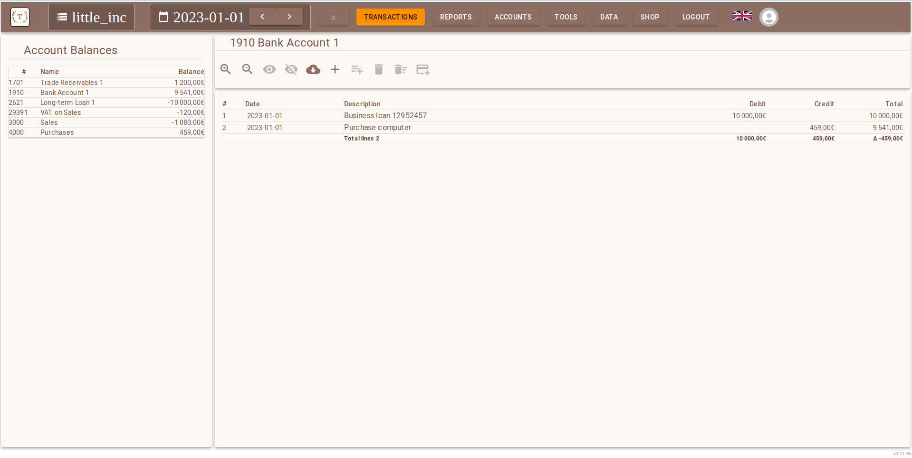

# Tasenor Bookkeeper

This is a monorepo for developing Tasenor Bookkeeper. For the latest published developer documentation, see
[https://docs.stg.tasenor.com/](https://docs.stg.tasenor.com/).

## AI assistants (MCP)

Bookkeeper can be used from AI assistants such as Claude through the [MCP](https://modelcontextprotocol.io)
server in [apps/mcp](./apps/mcp/README.md). The assistant can read the books (periods, accounts, balances,
reports, ledgers, entry search, documents) and propose new documents as drafts. It cannot book anything
itself: drafts are listed at the top of the Transactions page, and a person confirms or rejects them there.
The assistant sees exactly what its user sees, since every call goes through the API with that user's token.

The production server is at `https://mcp.tasenor.com/mcp`. Add it as a remote MCP server and log in with
your Bookkeeper email and password when asked; the login lasts 30 days.

* claude.ai: Settings → Connectors → Add custom connector, URL `https://mcp.tasenor.com/mcp`.
* Claude Code: `claude mcp add --transport http tasenor https://mcp.tasenor.com/mcp`, then `/mcp` to log in.

It also runs locally over stdio with a token, for one user. See [apps/mcp/README.md](./apps/mcp/README.md)
for the tools, both modes, and deployment.

## Content

### Applications

* [Bookkeeper Backend](./apps/bookkeeper-api/README.md) API for Bookkeeper.
* [Bookkeeper UI](./apps/bookkeeper/README.md) UI for Bookkeeper.
* [CLI](./apps/cli/README.md) Command-line API access.
* [MCP](./apps/mcp/README.md) MCP server for AI assistants (stdio and remote with OAuth).

### Databases

* [Databases](./databases/README.md) Development databases.

### Librariers

* [Tasenor Common](./packages/tasenor-common/README.md) Type defintions and tools for both browser and Node.
* [Tasenor Common UI](./packages/tasenor-common-ui/README.md) Shared components for browser.
* [Tasenor Common Node](./packages/tasenor-common-node/README.md) Node libraries for mainly server use.
* [Unit Tests](./unit-tests/README.md) Unit tests and testing utilities.

### Configurations

* [Tasenor Config](./packages/tasenor-config/README.md)

### Turbo Commands

* `turbo audit` Build all buildable packages.
* `turbo build` Build all buildable packages.
* `turbo demo` Launch local demo servers.
* `turbo dev` Launch local development environment.
* `turbo fix` Fix all fixable syntax checks.
* `turbo lint` Syntax check all.
* `turbo test` Run all tests.
* `turbo release` Increase patch level and publish all public NPM packages.
* `turbo show-version` List all versions from published packages.
